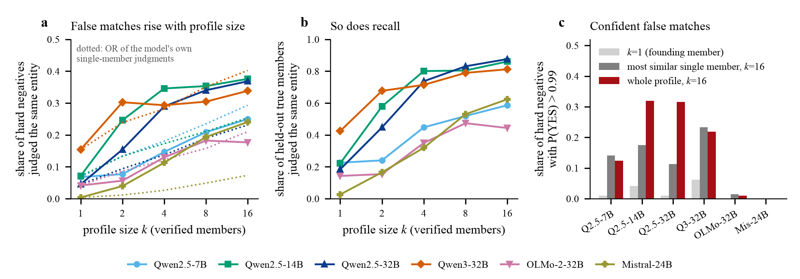

<div align="center">

# Profile Accretion

### Code and data for *Growing Clusters Lower the Bar: Profile Accretion in LLM-Based Incremental Entity Resolution*

Huixue Han · Yu-Chu Tian\*
School of Computer Science, Queensland University of Technology

[](#citation)
[](LICENSE)
[](DATA_LICENSE.md)
[](requirements.txt)

</div>

When an LLM decides whether a new record belongs to an existing cluster, incremental entity resolution (ER) pipelines show it the records already linked to that cluster. Classical analyses of ER treat the matcher as an oracle whose answer depends only on the records compared. **For LLM matchers it also depends on how large the cluster has grown: the bigger the cluster, the less evidence a new record needs to join it.** This repository holds every model input and output behind the paper, the code that produced them, and the script that turns them into each number, table and figure.

<p align="center">
  
</p>
<p align="center"><sub><b>Fig. 1.</b> As the profile grows from 1 to 16 verified members, (a) false matches on similarly named companies and (b) recall of true members both rise, while discrimination barely moves; (c) Qwen2.5-14B and 32B become confidently wrong.</sub></p>

## Key findings

| | Result |
|---|---|
| **The criterion shifts** | From 1 to 16 members, the false match rate on hard negatives rises by **13.5–32.3 points** in six open-weight models (three families) and by **24.0 / 22.0 points** in Claude Sonnet 5 / Haiku 5.5, while AUC rises by only 0.05–0.08. |
| **Matches no member supports** | Three models exceed the OR of their own single-member judgments. Qwen2.5-32B gives 31.6% of hard negatives P(YES) > 0.99 with the full profile, against 11.3% for its most similar member alone. |
| **Errors snowball** | At equal profile size, one false merge raises acceptance of a second record from the intruder's company from 30.8% to 55.1% (Qwen2.5-32B), in every open model. |
| **A predictable scope** | The shift survives street addresses, three prompt variants and the BatchER and ComEM formats. It is absent on TED records, where one record with its full address already identifies the company. |
| **A simple remedy** | In online linking, one threshold set on labelled data for the required precision raises recall **1.3–2.1×** for five models, with no detectable loss of precision and no extra LLM calls. |

Ground truth comes from registry identifiers: French SIREN numbers in [FOPPA v1.1.3](https://doi.org/10.5281/zenodo.10879932), and Czech IČO and Bulgarian EIK numbers in [TED](https://data.europa.eu/data/datasets/ted-csv) contract award notices.

## Repository at a glance

```
.
├── experiments/            input construction and scoring code
│   ├── build_inputs.py, score_accretion.py, score_jobs.py, e2e_link.py   main design
│   └── address/ prompts/ systems/ closed/ ted/ fix/ length/ logodds/ review/   replication tracks
├── scripts/build_assets.py data/ → generated/ + figures/
├── data/
│   ├── raw/                model inputs and all model outputs (~224 MB)
│   └── derived/            summary tables; FINDINGS*.md document each track
├── generated/              numbers.tex (all 654 numbers in the paper as LaTeX macros) and table bodies
└── figures/                Fig. 1, Fig. 2, Fig. S1 (PDF and PNG)
```

## Quick start: rebuild every number without a GPU

All model outputs are included, so the analysis runs on a laptop in a few minutes:

```bash
python -m venv .venv && source .venv/bin/activate
pip install -r requirements.txt
python scripts/build_assets.py      # writes generated/*.tex and figures/
git diff --stat generated/          # empty: every number and table is reproduced
```

## Reproduce from scratch

**1. Build the inputs from FOPPA** (about 70 s; reproduces the `data/raw` inputs byte for byte)

```bash
python experiments/build_inputs.py --foppa <FOPPA_1.1.3_csv_dir> --out data/raw
python experiments/population_stats.py --foppa <FOPPA_1.1.3_csv_dir> --out data/raw   # sample statistics
```

**2. Score the open-weight models** (`pip install -r requirements-gpu.txt`; one 80 GB GPU, bfloat16)

```bash
# controlled profiles
python experiments/score_accretion.py --items data/raw/items_all.json --model <hf_id> --out scores_<model>.jsonl
# mitigations and contamination
python experiments/score_jobs.py --items data/raw/jobs_mitig.jsonl --model <hf_id> --out mitig_<model>.jsonl
# online linking
python experiments/e2e_link.py --blocks data/raw/blocks_e2e.json --model <hf_id> --out e2e_<model>.jsonl
```

| Model | Hardware | Notes |
|---|---|---|
| Qwen2.5-7B/14B/32B-Instruct, Qwen3-32B | 1 × H100 80 GB | Qwen3 with thinking disabled |
| OLMo-2-0325-32B-Instruct | 2 × A100 40 GB | `device_map="auto"`, `--max_tokens_batch 6000`, `--bs 8` for online linking; `experiments/wrapper_nonqwen.sh` |
| Mistral-Small-24B-Instruct-2501 | 1 × H100 | `experiments/wrapper_mistral.sh` |

**3. Run the replication tracks.** Each folder's script docstrings describe its inputs, which are rebuilt from FOPPA or the TED CAN CSV extract and scored with the same next-token protocol. Summaries come from each track's `summarize_*.py`, `experiments/systems/batcher_q1_shift.py` and `experiments/fix/sweep/cv_operating_point.py`.

| Track | What it tests |
|---|---|
| `address/` | street address added to every record |
| `prompts/` | prompt variants V1–V3 (`prompts.md`) |
| `systems/` | BatchER, ComEM and LLM-CER prompting formats (`strategies.md`) |
| `closed/` | Claude Sonnet 5 and Haiku 5.5, majority vote over sampled answers |
| `ted/` | Czech and Bulgarian suppliers from TED, a second registry-keyed dataset |
| `fix/` | online-linking remedies: size-calibrated thresholds, cluster audits, operating-point sweep |
| `length/` | length control: the founding record repeated *k* times |
| `logodds/` | log-odds rescoring of the four Qwen models |
| `review/` | offline robustness checks: negative A/B split, name-similar negatives, TF-IDF reference, BCubed, saturation, call costs, Holm correction, TED by country |

**4. Regenerate numbers, tables and figures** with `python scripts/build_assets.py`.

> `data/raw/haiku_pilot_*` and `experiments/run_shard_claude.py` belong to an earlier Claude Haiku 4.5 pilot that the closed-model track replaces.

<details>
<summary><b>Running on a PBS cluster</b></summary>

The `wrapper*.sh` launchers were written for a PBS cluster with Apptainer. Set `SCRATCH` to a directory that holds

- `sif/torch-cuda.sif`: PyTorch container
- `g2p/pylibs`: transformers and dependencies installed with `pip --target`
- `cache/hf`: Hugging Face cache

then run a wrapper from the job directory:

```bash
SCRATCH=/scratch/$USER bash experiments/wrapper.sh
```

</details>

## Data and licences

- **Code** (`experiments/`, `scripts/`): MIT, see [`LICENSE`](LICENSE).
- **Source records** in `data/raw/` come from [FOPPA v1.1.3](https://doi.org/10.5281/zenodo.10879932) (CC BY 4.0) and the [TED CSV dataset](https://data.europa.eu/data/datasets/ted-csv) (EU reuse policy) and remain under those terms. Only the strings needed to rebuild the prompts are included.
- **Model outputs and derived tables**: CC BY 4.0.

Details are in [`DATA_LICENSE.md`](DATA_LICENSE.md). Please cite FOPPA (Potin et al., *Scientific Data* 10:303, 2023) and the TED CSV dataset when reusing the data.

## Citation

```bibtex
@inproceedings{han2027accretion,
  title     = {Growing Clusters Lower the Bar: Profile Accretion in {LLM}-Based Incremental Entity Resolution},
  author    = {Han, Huixue and Tian, Yu-Chu},
  booktitle = {Proceedings of MiTA 2027},
  year      = {2027},
  note      = {Submitted}
}
```

\* Corresponding author.
